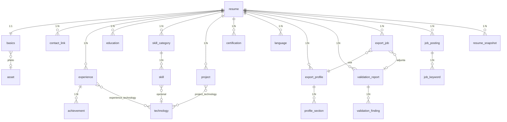

# CV-ATS — Especificación técnica completa

> Documento de trabajo para agentes de código. Cada sección es autocontenida y tiene criterios de aceptación. No inventar alcance fuera de este documento; si hay ambigüedad, elegir la opción más simple que cumpla el criterio y dejarlo anotado en `docs/DECISIONS.md`.

---

## 0. Resumen ejecutivo

Aplicación web **local** (single-user, sin autenticación) para crear, editar, validar y exportar hojas de vida en dos destinos:

| Destino | Objetivo | Plantilla | Validador |
|---|---|---|---|
| `ats` (plataformas / portales) | Máxima compatibilidad con parsers ATS. Inspirado en el PDF de LinkedIn pero corregido. | Una columna, sin foto, sin color, Arial/Calibri | Estricto: bloquea exportación en errores |
| `mail` (envío por correo) | Impacto visual para un humano. | Dos columnas, foto opcional, color de acento, temas | Suave: solo advierte |

Mismo contenido → dos renders. Todo el contenido vive en SQLite con relaciones formales. Exporta PDF (texto real, extraíble), DOCX y JSON.

**Gestión del proyecto: `uv` para todo** (Python, dependencias, scripts, lock, entornos, ejecución de herramientas).

---

## 1. Stack y decisiones cerradas

| Área | Decisión | Motivo |
|---|---|---|
| Python | 3.12 (fijado en `.python-version`, instalado por `uv python install 3.12`) | Estable, soportado por todas las libs |
| Gestor | `uv` ≥ 0.4 | Lock reproducible, rápido, scripts |
| Web | FastAPI + Uvicorn | Async, tipado, OpenAPI gratis |
| Templates | Jinja2 | Estándar; se usa para HTML del editor y para el PDF |
| Interactividad | HTMX 2 + Alpine.js (CDN vendorizado en `static/vendor/`) | Sin build step de frontend |
| Drag & drop | SortableJS (vendorizado) | Reordenar secciones e ítems |
| ORM | SQLAlchemy 2.0 (estilo `Mapped[]`) | Relaciones explícitas, tipado |
| Migraciones | Alembic | Esquema versionado |
| Validación de datos | Pydantic v2 | Esquemas de entrada/salida |
| BD | SQLite (`data/cv.db`), `PRAGMA foreign_keys=ON` obligatorio | Local, cero infra |
| PDF | WeasyPrint (primario). Plan B: Playwright/Chromium | Texto real seleccionable, CSS Paged Media |
| DOCX | python-docx | Exportación secundaria |
| Importar PDF | pdfplumber | Extracción de texto por líneas |
| Importar DOCX | python-docx | — |
| Match vacante | scikit-learn (TF-IDF) | Simple, offline |
| Lint/format | ruff | Único tool |
| Tipado | mypy (strict en `app/`, `models/`, `validator/`) | — |
| Tests | pytest + pytest-asyncio + httpx | — |
| Pre-commit | pre-commit con ruff, mypy, `uv lock --check` | — |

Decisiones no negociables:

1. **Nunca** exportar PDF rasterizado. El texto debe ser extraíble.
2. **Nunca** usar `<table>` en la plantilla `ats`.
3. Toda regla del validador es una función pura, testeable sin BD.
4. Toda escritura a BD pasa por un servicio (`services/`), nunca desde el router.
5. Fechas siempre `date` en BD (día = 01 si solo se conoce mes/año). El formato es asunto del render.

---

## 2. Configuración con `uv`

### 2.1 Bootstrap

```bash
uv python install 3.12
uv init cv-ats --package     # si el repo no existe
cd cv-ats
uv sync                      # crea .venv e instala todo desde uv.lock
uv run alembic upgrade head  # crea data/cv.db
uv run cv-ats serve          # http://127.0.0.1:8000
```

### 2.2 `pyproject.toml` (contenido mínimo obligatorio)

```toml
[project]
name = "cv-ats"
version = "0.1.0"
description = "Editor y validador de hojas de vida con exportación ATS y diseño"
requires-python = ">=3.12"
dependencies = [
  "fastapi>=0.115",
  "uvicorn[standard]>=0.30",
  "jinja2>=3.1",
  "python-multipart>=0.0.9",
  "sqlalchemy>=2.0",
  "alembic>=1.13",
  "pydantic>=2.8",
  "pydantic-settings>=2.4",
  "weasyprint>=62",
  "python-docx>=1.1",
  "pdfplumber>=0.11",
  "scikit-learn>=1.5",
  "pillow>=10",
  "typer>=0.12",
]

[project.scripts]
cv-ats = "app.cli:main"

[dependency-groups]
dev = [
  "pytest>=8",
  "pytest-asyncio>=0.23",
  "httpx>=0.27",
  "ruff>=0.6",
  "mypy>=1.11",
  "pre-commit>=3.8",
  "types-python-dateutil",
]
pdf-fallback = ["playwright>=1.46"]

[build-system]
requires = ["hatchling"]
build-backend = "hatchling.build"

[tool.ruff]
line-length = 100
target-version = "py312"

[tool.ruff.lint]
select = ["E", "F", "I", "B", "UP", "N", "S", "SIM", "RUF"]
ignore = ["S101"]  # assert en tests

[tool.mypy]
python_version = "3.12"
strict = true
plugins = ["pydantic.mypy"]
files = ["app", "models", "validator", "export", "importer", "services"]

[tool.pytest.ini_options]
asyncio_mode = "auto"
testpaths = ["tests"]
```

### 2.3 Comandos estándar (documentar en README y `Makefile`/`justfile` opcional)

| Acción | Comando |
|---|---|
| Instalar / sincronizar | `uv sync` |
| Agregar dependencia | `uv add <pkg>` / `uv add --group dev <pkg>` |
| Ejecutar servidor | `uv run cv-ats serve --reload` |
| Migración nueva | `uv run alembic revision --autogenerate -m "msg"` |
| Aplicar migraciones | `uv run alembic upgrade head` |
| Tests | `uv run pytest -q` |
| Lint + format | `uv run ruff check --fix . && uv run ruff format .` |
| Tipos | `uv run mypy` |
| Pre-commit | `uv run pre-commit install` |
| Exportar por CLI | `uv run cv-ats export --resume 1 --profile ats --out out/` |
| Validar por CLI | `uv run cv-ats validate --resume 1 --profile ats` |
| Verificar lock | `uv lock --check` |

### 2.4 Reglas

- `uv.lock` **se versiona**. `.venv/` no.
- CI (GitHub Actions) usa `astral-sh/setup-uv` y ejecuta: `uv sync --frozen`, `uv run ruff check`, `uv run mypy`, `uv run pytest`.
- Nunca usar `pip` directo ni `requirements.txt`.

---

## 3. Estructura del repositorio

```
cv-ats/
├── pyproject.toml
├── uv.lock
├── .python-version
├── .pre-commit-config.yaml
├── alembic.ini
├── alembic/
│   ├── env.py
│   └── versions/
├── app/
│   ├── main.py            # create_app(), montaje de routers y static
│   ├── cli.py             # Typer: serve, validate, export, import, seed
│   ├── config.py          # Settings (pydantic-settings): DB_URL, DATA_DIR, PDF_ENGINE
│   ├── db.py              # engine, SessionLocal, get_session, PRAGMA foreign_keys
│   ├── deps.py            # dependencias FastAPI
│   └── routers/
│       ├── resumes.py
│       ├── basics.py
│       ├── experiences.py
│       ├── education.py
│       ├── skills.py
│       ├── projects.py
│       ├── certifications.py
│       ├── languages.py
│       ├── profiles.py    # perfiles de exportación
│       ├── assets.py      # foto
│       ├── validate.py
│       ├── export.py
│       ├── importer.py
│       └── match.py
├── models/
│   ├── __init__.py
│   ├── base.py            # Base, mixins (TimestampMixin, OrderMixin)
│   ├── enums.py
│   ├── resume.py
│   ├── basics.py
│   ├── experience.py
│   ├── education.py
│   ├── skill.py
│   ├── project.py
│   ├── certification.py
│   ├── language.py
│   ├── technology.py
│   ├── asset.py
│   ├── export_profile.py
│   ├── job_posting.py
│   └── audit.py           # validation_report, export_job
├── schemas/               # Pydantic (entrada/salida), espejo de models/
├── services/              # lógica de negocio, única capa que escribe en BD
├── validator/
│   ├── engine.py          # run(cv, profile) -> Report
│   ├── rules/
│   │   ├── structure.py
│   │   ├── content.py
│   │   ├── contact.py
│   │   ├── dates.py
│   │   ├── length.py
│   │   └── technical.py   # post-export: round-trip del PDF
│   └── registry.py        # decorador @rule(...)
├── render/
│   ├── renderer.py        # render(cv, profile) -> html
│   ├── context.py         # construye el contexto Jinja a partir del ORM
│   ├── filters.py         # fmt_date, join_tech, etc.
│   └── templates/
│       ├── ats/
│       │   ├── base.html
│       │   └── ats.css
│       └── mail/
│           ├── base.html
│           ├── themes/
│           │   ├── slate.css
│           │   ├── ocean.css
│           │   └── graphite.css
│           └── mail.css
├── export/
│   ├── pdf.py             # WeasyPrint; fallback Playwright
│   ├── docx.py
│   ├── json_export.py
│   └── verify.py          # re-parsea el PDF y compara
├── importer/
│   ├── pdf_importer.py
│   ├── docx_importer.py
│   └── sectionizer.py     # heurísticas para detectar secciones
├── match/
│   └── keywords.py
├── web/                   # templates del editor (Jinja + HTMX)
│   ├── layout.html
│   ├── editor/
│   │   ├── index.html
│   │   ├── section_experience.html
│   │   ├── item_experience.html
│   │   └── ... (uno por sección)
│   ├── preview.html
│   └── partials/
├── static/
│   ├── css/editor.css
│   ├── js/editor.js
│   └── vendor/            # htmx.min.js, alpine.min.js, sortable.min.js
├── data/                  # cv.db, uploads/ (gitignored)
├── tests/
│   ├── conftest.py        # BD en memoria, fixtures de CV
│   ├── test_models.py
│   ├── test_services.py
│   ├── test_validator_*.py
│   ├── test_render.py
│   ├── test_export_pdf.py
│   ├── test_export_verify.py
│   ├── test_importer.py
│   └── test_api.py
└── docs/
    ├── DECISIONS.md
    └── ATS_RULES.md       # copia legible de las reglas
```

---

## 4. Modelo de datos

### 4.1 Diagrama entidad-relación



### 4.2 Convenciones globales

- PK: `id INTEGER PRIMARY KEY AUTOINCREMENT`.
- Todas las tablas con `TimestampMixin`: `created_at`, `updated_at` (UTC, `DEFAULT CURRENT_TIMESTAMP`, `onupdate`).
- Tablas ordenables con `OrderMixin`: `position INTEGER NOT NULL DEFAULT 0` + `UNIQUE(parent_fk, position)` diferido a nivel servicio (reordenar en transacción).
- FK siempre con `ON DELETE` explícito (ver tabla). `PRAGMA foreign_keys=ON` en cada conexión (event listener en `db.py`).
- Enums como `Enum` de Python mapeados a `VARCHAR` con `CHECK`.
- Índices en toda FK.

### 4.3 Enums (`models/enums.py`)

```python
class Destination(StrEnum): ATS = "ats"; MAIL = "mail"
class Density(StrEnum): COMPACT = "compact"; NORMAL = "normal"; WIDE = "wide"
class ShowIn(StrEnum): ATS = "ats"; MAIL = "mail"; BOTH = "both"
class SectionKey(StrEnum):
    SUMMARY="summary"; EXPERIENCE="experience"; EDUCATION="education"
    SKILLS="skills"; PROJECTS="projects"; CERTIFICATIONS="certifications"; LANGUAGES="languages"
class LinkKind(StrEnum): LINKEDIN="linkedin"; GITHUB="github"; WEBSITE="website"; PORTFOLIO="portfolio"; OTHER="other"
class DegreeLevel(StrEnum): TECHNICAL="technical"; TECHNOLOGIST="technologist"; BACHELOR="bachelor"; SPECIALIZATION="specialization"; MASTER="master"; PHD="phd"; COURSE="course"; OTHER="other"
class LanguageLevel(StrEnum): A1="A1"; A2="A2"; B1="B1"; B2="B2"; C1="C1"; C2="C2"; NATIVE="native"
class SkillLevel(StrEnum): BASIC="basic"; INTERMEDIATE="intermediate"; ADVANCED="advanced"; EXPERT="expert"
class Severity(StrEnum): ERROR="error"; WARNING="warning"; INFO="info"
class ExportFormat(StrEnum): PDF="pdf"; DOCX="docx"; JSON="json"
class ExportStatus(StrEnum): PENDING="pending"; DONE="done"; FAILED="failed"; BLOCKED="blocked"
```

### 4.4 Tablas

#### `resume` — raíz de un CV
| Columna | Tipo | Restricciones |
|---|---|---|
| id | INTEGER | PK |
| name | VARCHAR(120) | NOT NULL, UNIQUE (ej. "General", "Backend Bancario") |
| language | VARCHAR(5) | NOT NULL, DEFAULT 'es', CHECK IN ('es','en') |
| is_default | BOOLEAN | NOT NULL DEFAULT 0. Índice parcial único: solo uno con 1 |
| notes | TEXT | NULL |

Relaciones: todas las hijas con `cascade="all, delete-orphan"`; `basics` con `uselist=False`.

#### `basics` — datos personales (1:1 con resume)
| Columna | Tipo | Restricciones |
|---|---|---|
| id | INTEGER | PK |
| resume_id | INTEGER | FK resume(id) ON DELETE CASCADE, UNIQUE, NOT NULL |
| full_name | VARCHAR(120) | NOT NULL |
| headline | VARCHAR(160) | NOT NULL (ej. "Ingeniero de Sistemas · Backend Python") |
| email | VARCHAR(254) | NOT NULL, validado por Pydantic `EmailStr` |
| phone | VARCHAR(30) | NOT NULL, normalizado E.164 (`+57...`) |
| city | VARCHAR(80) | NOT NULL |
| region | VARCHAR(80) | NULL |
| country | VARCHAR(2) | NOT NULL, ISO-3166-1 alpha-2 |
| summary | TEXT | NULL, máx 1200 chars (CHECK length) |
| photo_asset_id | INTEGER | FK asset(id) ON DELETE SET NULL, NULL |

#### `contact_link`
| Columna | Tipo | Restricciones |
|---|---|---|
| id | INTEGER | PK |
| resume_id | INTEGER | FK resume ON DELETE CASCADE, NOT NULL |
| kind | VARCHAR(20) | CHECK LinkKind |
| label | VARCHAR(80) | NULL (texto visible) |
| url | VARCHAR(500) | NOT NULL, `HttpUrl` |
| position | INTEGER | NOT NULL |
| | | UNIQUE(resume_id, kind) salvo `other` (validar en servicio) |

#### `asset` — archivos subidos (foto)
| Columna | Tipo | Restricciones |
|---|---|---|
| id | INTEGER | PK |
| filename | VARCHAR(255) | NOT NULL, nombre en `data/uploads/` (uuid + ext) |
| original_name | VARCHAR(255) | NOT NULL |
| mime | VARCHAR(50) | CHECK IN ('image/jpeg','image/png','image/webp') |
| width | INTEGER | NOT NULL |
| height | INTEGER | NOT NULL |
| size_bytes | INTEGER | NOT NULL, CHECK ≤ 5_000_000 |
| sha256 | CHAR(64) | NOT NULL, UNIQUE (dedupe) |

Al subir: Pillow abre, valida, convierte a JPEG/PNG, recorta cuadrado centrado y guarda versión `_400.jpg` para render.

#### `experience`
| Columna | Tipo | Restricciones |
|---|---|---|
| id | INTEGER | PK |
| resume_id | INTEGER | FK resume ON DELETE CASCADE, NOT NULL, INDEX |
| company | VARCHAR(120) | NOT NULL |
| role | VARCHAR(120) | NOT NULL |
| employment_type | VARCHAR(30) | NULL (full-time, contractor, freelance, internship) |
| city | VARCHAR(80) | NULL |
| country | VARCHAR(2) | NULL |
| remote | BOOLEAN | NOT NULL DEFAULT 0 |
| start_date | DATE | NOT NULL |
| end_date | DATE | NULL; NULL = actual |
| is_current | BOOLEAN | NOT NULL DEFAULT 0. CHECK: `(is_current=1 AND end_date IS NULL) OR (is_current=0 AND end_date IS NOT NULL)` |
| description | TEXT | NULL (contexto breve, máx 400) |
| show_in | VARCHAR(5) | CHECK ShowIn, DEFAULT 'both' |
| position | INTEGER | NOT NULL |
| | | CHECK `end_date IS NULL OR end_date >= start_date` |

Índice compuesto `(resume_id, start_date DESC)` para orden cronológico automático.

#### `achievement` — logros (bullets) de una experiencia
| Columna | Tipo | Restricciones |
|---|---|---|
| id | INTEGER | PK |
| experience_id | INTEGER | FK experience ON DELETE CASCADE, NOT NULL, INDEX |
| text | VARCHAR(300) | NOT NULL |
| metric_value | VARCHAR(40) | NULL (ej. "35%", "2x", "$120k") — se usa en validador `content.metric` |
| show_in | VARCHAR(5) | CHECK ShowIn, DEFAULT 'both' |
| position | INTEGER | NOT NULL |

#### `technology` — catálogo normalizado
| Columna | Tipo | Restricciones |
|---|---|---|
| id | INTEGER | PK |
| name | VARCHAR(60) | NOT NULL, UNIQUE (case-insensitive via `COLLATE NOCASE`) |
| canonical | VARCHAR(60) | NOT NULL (ej. "PostgreSQL" para "postgres") |
| category | VARCHAR(40) | NULL (language, framework, db, cloud, tool) |

Se hace **seed** con ~150 tecnologías comunes (`cv-ats seed`). El servicio hace `get_or_create` por `canonical`.

#### `experience_technology` (M2M)
| Columna | Tipo | Restricciones |
|---|---|---|
| experience_id | INTEGER | FK experience ON DELETE CASCADE |
| technology_id | INTEGER | FK technology ON DELETE CASCADE |
| position | INTEGER | NOT NULL |
| | | PK(experience_id, technology_id) |

#### `project`
| Columna | Tipo | Restricciones |
|---|---|---|
| id | INTEGER | PK |
| resume_id | INTEGER | FK resume ON DELETE CASCADE, NOT NULL, INDEX |
| name | VARCHAR(120) | NOT NULL |
| role | VARCHAR(120) | NULL |
| description | VARCHAR(600) | NOT NULL |
| url | VARCHAR(500) | NULL |
| start_date | DATE | NULL |
| end_date | DATE | NULL, CHECK ≥ start_date |
| show_in | VARCHAR(5) | CHECK ShowIn |
| position | INTEGER | NOT NULL |

#### `project_technology` (M2M) — misma forma que `experience_technology`.

#### `education`
| Columna | Tipo | Restricciones |
|---|---|---|
| id | INTEGER | PK |
| resume_id | INTEGER | FK resume ON DELETE CASCADE, NOT NULL, INDEX |
| institution | VARCHAR(160) | NOT NULL |
| degree | VARCHAR(160) | NOT NULL (título) |
| level | VARCHAR(20) | CHECK DegreeLevel |
| field | VARCHAR(120) | NULL |
| city | VARCHAR(80) | NULL |
| start_date | DATE | NULL |
| end_date | DATE | NULL |
| in_progress | BOOLEAN | NOT NULL DEFAULT 0 |
| gpa | VARCHAR(10) | NULL |
| description | VARCHAR(400) | NULL |
| show_in | VARCHAR(5) | CHECK ShowIn |
| position | INTEGER | NOT NULL |

#### `skill_category` y `skill`
`skill_category`: id, resume_id (FK CASCADE, INDEX), name VARCHAR(60) NOT NULL, position, `UNIQUE(resume_id, name)`.

`skill`: id, category_id (FK skill_category CASCADE, INDEX), name VARCHAR(60) NOT NULL, level (CHECK SkillLevel, NULL), years INTEGER NULL CHECK 0..50, technology_id (FK technology SET NULL, NULL), show_in, position, `UNIQUE(category_id, name)`.

#### `certification`
id, resume_id (FK CASCADE, INDEX), name VARCHAR(160) NOT NULL, issuer VARCHAR(120) NOT NULL, issue_date DATE NULL, expiry_date DATE NULL (CHECK ≥ issue_date), credential_id VARCHAR(80) NULL, url VARCHAR(500) NULL, show_in, position.

#### `language`
id, resume_id (FK CASCADE, INDEX), name VARCHAR(40) NOT NULL, level (CHECK LanguageLevel) NOT NULL, position, `UNIQUE(resume_id, name)`.

#### `export_profile` — configuración de salida
| Columna | Tipo | Restricciones |
|---|---|---|
| id | INTEGER | PK |
| resume_id | INTEGER | FK resume ON DELETE CASCADE, NOT NULL, INDEX |
| name | VARCHAR(60) | NOT NULL, UNIQUE(resume_id, name) |
| destination | VARCHAR(5) | CHECK Destination, NOT NULL |
| theme | VARCHAR(40) | NULL; obligatorio si destination='mail' (CHECK) ; DEBE ser NULL si 'ats' |
| accent_color | CHAR(7) | NULL, CHECK regex `#[0-9A-Fa-f]{6}` ; NULL si 'ats' |
| density | VARCHAR(10) | CHECK Density, DEFAULT 'normal' |
| include_photo | BOOLEAN | NOT NULL DEFAULT 0 ; CHECK: si destination='ats' → 0 |
| max_pages | INTEGER | NOT NULL DEFAULT 2, CHECK IN (1,2,3) |
| date_format | VARCHAR(12) | NOT NULL DEFAULT 'MM/YYYY', CHECK IN ('MM/YYYY','MMM YYYY','YYYY') |
| font_family | VARCHAR(40) | DEFAULT 'Arial'; si 'ats' CHECK IN ('Arial','Calibri','Helvetica','Georgia') |

Al crear un `resume`, el servicio crea automáticamente dos perfiles: `Plataforma` (ats) y `Correo` (mail, theme='slate').

#### `profile_section` — orden y visibilidad de secciones por perfil
| Columna | Tipo | Restricciones |
|---|---|---|
| id | INTEGER | PK |
| profile_id | INTEGER | FK export_profile ON DELETE CASCADE, NOT NULL, INDEX |
| section | VARCHAR(20) | CHECK SectionKey |
| visible | BOOLEAN | NOT NULL DEFAULT 1 |
| position | INTEGER | NOT NULL |
| title_override | VARCHAR(60) | NULL (ej. "Experiencia profesional") |
| | | UNIQUE(profile_id, section), UNIQUE(profile_id, position) |

Para `ats` el servicio **rechaza** reordenar `experience` por debajo de `skills` (regla `structure.order`) — se permite pero se marca error en validador; mejor: se permite la escritura y el validador lo reporta.

#### `resume_snapshot` — versiones inmutables
id, resume_id (FK CASCADE), label VARCHAR(80), payload JSON (dump completo del esquema Pydantic `ResumeOut`), created_at. Se crea al exportar y manualmente ("Guardar versión"). Restaurar = servicio que reconstruye desde JSON en transacción.

#### `validation_report` y `validation_finding`
`validation_report`: id, resume_id (FK CASCADE), profile_id (FK export_profile SET NULL), score INTEGER CHECK 0..100, errors INTEGER, warnings INTEGER, created_at.

`validation_finding`: id, report_id (FK CASCADE, INDEX), rule_id VARCHAR(60) NOT NULL, severity CHECK Severity, message VARCHAR(300), section VARCHAR(20) NULL, entity VARCHAR(30) NULL, entity_id INTEGER NULL, suggestion VARCHAR(300) NULL.

#### `export_job`
id, resume_id (FK CASCADE), profile_id (FK export_profile RESTRICT), format CHECK ExportFormat, status CHECK ExportStatus, output_path VARCHAR(500) NULL, report_id (FK validation_report SET NULL), snapshot_id (FK resume_snapshot SET NULL), error TEXT NULL, pages INTEGER NULL, roundtrip_ok BOOLEAN NULL, created_at.

#### `job_posting` y `job_keyword`
`job_posting`: id, resume_id (FK CASCADE), title VARCHAR(160), company VARCHAR(120) NULL, raw_text TEXT NOT NULL, created_at.

`job_keyword`: id, posting_id (FK CASCADE, INDEX), keyword VARCHAR(60), weight REAL, found_in_cv BOOLEAN. UNIQUE(posting_id, keyword).

### 4.5 Reglas de integridad a nivel servicio (no expresables en SQL)

1. Reordenar (`position`) siempre en una transacción que reescribe todas las posiciones del padre (0..n-1) — evita colisiones del UNIQUE.
2. `is_default`: al marcar uno, desmarcar los demás en la misma transacción.
3. Al borrar un `asset` referenciado por `basics.photo_asset_id` → SET NULL (FK) y borrar el archivo del disco.
4. Al cambiar `export_profile.destination` a `ats` → forzar `include_photo=0`, `theme=NULL`, `accent_color=NULL`.
5. `technology.get_or_create` normaliza: trim, colapsa espacios, busca por `canonical` case-insensitive.

### 4.6 Alembic

- `alembic/env.py` importa `models` completo y usa `render_as_batch=True` (SQLite necesita batch para ALTER).
- Migración inicial `0001_initial` generada con autogenerate y **revisada a mano** (los CHECK y índices parciales se agregan manualmente).
- Test `test_models.py::test_migrations_match_models`: `alembic upgrade head` en BD temporal + `alembic check` sin diferencias.

---

## 5. Esquemas Pydantic (`schemas/`)

Patrón por entidad: `XCreate`, `XUpdate` (todo opcional), `XOut` (con `id`, `from_attributes=True`).

Validadores clave:

- `BasicsCreate.phone`: normalizar a E.164 (usar regex + país por defecto `CO`).
- `BasicsCreate.email`: `EmailStr`.
- `ExperienceCreate`: `model_validator` que reproduce el CHECK de `is_current`/`end_date` y devuelve mensaje humano.
- Fechas de entrada aceptan `YYYY-MM` y `YYYY-MM-DD`; se guardan como `date` (día 01).
- `AchievementCreate.text`: strip, colapsar espacios, quitar bullet inicial ("•", "-", "*").
- `ExportProfileCreate`: `model_validator` con la lógica ats/mail (foto, theme, color).
- `ResumeOut`: árbol completo anidado; es el **contrato** usado por render, validador, snapshot y export JSON. Todo lo demás consume `ResumeOut`, nunca el ORM directo.

---

## 6. API (FastAPI)

Prefijo `/api`. Todas devuelven JSON; los routers HTMX (`/ui/...`) devuelven fragmentos HTML y reutilizan los mismos servicios.

| Método | Ruta | Descripción |
|---|---|---|
| GET/POST | `/api/resumes` | listar / crear (crea basics vacío + 2 perfiles + 7 profile_section por perfil) |
| GET/PATCH/DELETE | `/api/resumes/{id}` | — |
| POST | `/api/resumes/{id}/duplicate` | clona todo el árbol (nuevo nombre) |
| GET/PUT | `/api/resumes/{id}/basics` | — |
| CRUD | `/api/resumes/{id}/links` | + `PUT .../order` con lista de ids |
| CRUD | `/api/resumes/{id}/experiences` | + `PUT .../order` |
| CRUD | `/api/experiences/{id}/achievements` | + order |
| PUT | `/api/experiences/{id}/technologies` | lista de nombres → get_or_create |
| CRUD | `/api/resumes/{id}/education`, `/projects`, `/certifications`, `/languages` | + order |
| CRUD | `/api/resumes/{id}/skill-categories`, `/api/skill-categories/{id}/skills` | + order |
| GET | `/api/technologies?q=` | autocompletado |
| CRUD | `/api/resumes/{id}/profiles` | — |
| PUT | `/api/profiles/{id}/sections` | orden + visibilidad completos |
| POST | `/api/assets` (multipart) | sube foto → `asset` |
| POST | `/api/resumes/{id}/validate?profile_id=` | devuelve `ValidationReportOut` y persiste |
| GET | `/api/resumes/{id}/preview?profile_id=&density=` | HTML renderizado |
| POST | `/api/resumes/{id}/export` body `{profile_id, formats:[...], with_photo_variant:bool}` | crea `export_job`, devuelve rutas |
| GET | `/api/exports/{job_id}/download?format=` | `FileResponse` |
| POST | `/api/resumes/{id}/snapshots` / `POST /api/snapshots/{id}/restore` | — |
| POST | `/api/resumes/{id}/import` (multipart pdf/docx) | devuelve `ImportPreview` (no escribe) |
| POST | `/api/resumes/{id}/import/apply` | aplica el preview editado |
| POST | `/api/resumes/{id}/postings` | pega vacante → keywords + match |
| GET | `/api/postings/{id}/match` | faltantes / presentes |

Errores: `HTTPException` 422 con `{"detail":[{"field","msg"}]}`. Errores de dominio → `409`.

---

## 7. Editor (UI)

Ruta `/` → lista de CVs. `/resumes/{id}/edit` → editor.

Layout: **izquierda** formulario por secciones (acordeón), **derecha** vista previa en `<iframe>` que recarga por HTMX (`hx-trigger="cv-changed from:body"`) con debounce 500 ms.

Barra superior:
- Selector de **perfil** (Plataforma / Correo / custom) → cambia preview y reglas.
- Selector de **densidad** (compacto/normal/amplio).
- Toggle **"Mostrar solo contenido de este destino"** (filtra ítems con `show_in`).
- Indicador de páginas estimadas (el renderer devuelve `pages` en header `X-Pages`).
- Botón **Validar** → panel lateral con hallazgos, cada uno con enlace que hace scroll al campo (`data-entity`, `data-entity-id`).
- Botón **Exportar** → modal: formatos, perfil, "también versión sin foto", "guardar snapshot".

Comportamientos:
- Cada ítem (experiencia, logro, etc.) es un partial HTMX con `hx-put` al guardar y `hx-delete`.
- Reordenar con SortableJS → `PUT .../order`.
- Cada ítem tiene un selector `show_in` (ambos / solo ATS / solo correo) con icono.
- Logro: campo texto + campo `metric_value` + ayuda "Empieza con verbo de acción".
- Tecnologías: input con autocompletado (`/api/technologies?q=`) y chips.
- Foto: recorte cuadrado con preview; aviso fijo: "No se incluye en el destino Plataforma".
- Perfiles: pantalla para reordenar secciones (drag), ocultar, renombrar título; para `mail` elegir tema y color.
- Atajo `Ctrl+S` guarda todo lo pendiente.

Sin frameworks de build. CSS propio en `static/css/editor.css`. Accesible (labels, focus visible).

---

## 8. Render (`render/`)

`render(cv: ResumeOut, profile: ExportProfileOut, *, for_preview=False) -> RenderResult(html: str, pages: int|None)`

### 8.1 Contexto

`context.py` construye:
- `sections`: lista ordenada según `profile_section` visible.
- Cada ítem filtrado por `show_in ∈ {both, profile.destination}`.
- Experiencias ordenadas por `position`; si el perfil es `ats` y el usuario no reordenó, orden cronológico inverso.
- Fechas formateadas por `date_format` e idioma (`es`: "ene 2024", `en`: "Jan 2024"; "Actual"/"Present").
- Foto solo si `include_photo` y `destination == mail`.

### 8.2 Plantilla `ats`

- `@page { size: Letter; margin: 18mm 18mm }` (`A4` si `language='en'` y país no es US → dejar Letter por defecto Colombia/US).
- Una sola columna; `h1` nombre, línea de contacto en texto plano separada por ` | `.
- Encabezados de sección en mayúsculas, nombres canónicos: `RESUMEN PROFESIONAL`, `EXPERIENCIA PROFESIONAL`, `EDUCACIÓN`, `HABILIDADES`, `PROYECTOS`, `CERTIFICACIONES`, `IDIOMAS` (inglés: `SUMMARY`, `EXPERIENCE`, `EDUCATION`, `SKILLS`, …).
- Experiencia: línea 1 `Cargo — Empresa`, línea 2 `Ciudad · MM/AAAA – MM/AAAA`, bullets `<ul><li>`.
- Habilidades: `Categoría: skill, skill, skill` (texto plano, sin barras ni porcentajes).
- Prohibido: `<table>`, ``, iconos, columnas CSS, `position:absolute`, texto en header/footer de página, colores distintos a negro/gris #333.
- Fuente: `profile.font_family`, 10.5 pt normal; densidad ajusta 9.5 / 10.5 / 11.5 y márgenes 14 / 18 / 22 mm.
- `page-break-inside: avoid` en cada ítem de experiencia.

### 8.3 Plantilla `mail`

- Dos columnas con CSS Grid (`grid-template-columns: 32% 68%`). Sidebar: foto (círculo o cuadrado redondeado), contacto con iconos SVG inline, habilidades, idiomas. Main: nombre, headline, resumen, experiencia, proyectos, educación, certificaciones.
- Temas en `themes/*.css` definen variables: `--accent`, `--sidebar-bg`, `--text`, `--muted`, `--font-head`, `--font-body`. `accent_color` del perfil sobrescribe `--accent`.
- Tres temas iniciales: `slate` (gris azulado), `ocean` (azul), `graphite` (oscuro).
- Mantener texto real (no rasterizar). Sidebar se repite en cada página vía `position: running()` solo si WeasyPrint lo soporta; si no, sidebar solo en página 1 y página 2 a una columna.

### 8.4 Conteo de páginas

`export/pdf.py` renderiza a PDF en memoria (WeasyPrint `Document.pages`) y devuelve `len(pages)`. La preview llama a esto para mostrar el estimado.

---

## 9. Validador (`validator/`)

### 9.1 Motor

```python
@rule(id="contact.email_in_body", section="basics", severity={"ats": "error", "mail": "warning"}, weight=10)
def email_in_body(cv: ResumeOut, profile: ExportProfileOut) -> list[Finding]: ...
```

- `engine.run(cv, profile) -> Report(score, findings)`.
- `score = 100 - Σ(weight de errores) - Σ(weight/2 de warnings)`, mínimo 0.
- Reglas se descubren por import de `validator.rules.*`.
- Las reglas `technical.*` corren **después** de generar el PDF (reciben `PdfInfo`).
- Exportación `ats` se **bloquea** si hay ≥1 error (status `blocked`). `mail` nunca bloquea.

### 9.2 Catálogo de reglas

| id | Sección | ats | mail | peso | Descripción / sugerencia |
|---|---|---|---|---|---|
| `contact.email_present` | basics | error | error | 15 | Email obligatorio y válido |
| `contact.phone_present` | basics | error | warning | 10 | Teléfono en E.164 |
| `contact.location_present` | basics | warning | info | 3 | Ciudad y país |
| `contact.linkedin_present` | links | warning | info | 3 | Recomendado |
| `contact.url_plain` | links | error | – | 5 | URLs deben ser texto visible (no solo hipervínculo "aquí") |
| `structure.single_column` | profile | error | – | 15 | Forzado por plantilla; se verifica en HTML |
| `structure.no_tables` | profile | error | – | 15 | No `<table>` en HTML final |
| `structure.no_photo` | profile | error | – | 10 | `include_photo` debe ser 0 en ats |
| `structure.section_order` | profile | warning | – | 5 | Orden recomendado: resumen → experiencia → educación → habilidades |
| `structure.canonical_headings` | profile | error | – | 8 | Títulos override deben mapear a canónicos (lista blanca) |
| `structure.required_sections` | profile | error | warning | 10 | Experiencia y educación visibles y con ≥1 ítem |
| `content.summary_length` | summary | warning | warning | 4 | 200–600 caracteres |
| `content.summary_first_person` | summary | warning | info | 2 | Evitar "yo", "mi" |
| `content.min_achievements` | experience | warning | warning | 5 | ≥2 logros por experiencia (≥1 para < 6 meses) |
| `content.max_achievements` | experience | info | info | 1 | ≤6 logros |
| `content.action_verb` | achievement | warning | warning | 3 | Empieza con verbo de acción (lista es/en en `validator/data/verbs_{lang}.txt`) |
| `content.metric` | achievement | warning | info | 3 | Al menos 40% de logros con número/%/moneda o `metric_value` |
| `content.achievement_length` | achievement | warning | warning | 2 | 40–220 caracteres, 1–2 líneas |
| `content.no_pronouns` | achievement | info | – | 1 | Evitar "yo", "nosotros" |
| `content.skills_present` | skills | error | warning | 8 | ≥5 skills visibles |
| `content.skills_no_levels_ats` | skills | warning | – | 2 | No mostrar barras/porcentajes; los niveles se ocultan en ats |
| `content.keywords_from_experience` | skills | info | info | 2 | Tecnologías usadas en experiencias que no están en skills |
| `content.duplicate_skill` | skills | warning | warning | 2 | Mismo nombre en dos categorías |
| `dates.format_consistent` | all | error | warning | 6 | Un solo formato (viene del perfil; verifica override manual) |
| `dates.chronological` | experience | warning | info | 3 | Orden inverso cronológico |
| `dates.gap` | experience | info | – | 1 | Huecos > 6 meses (solo informar) |
| `dates.overlap_current` | experience | warning | warning | 2 | Más de un "actual" |
| `dates.future` | all | error | error | 5 | Fechas futuras (excepto expiry) |
| `dates.end_before_start` | all | error | error | 5 | — |
| `length.pages` | doc | error | warning | 10 | ≤ `max_pages` (post-render) |
| `length.min_content` | doc | warning | warning | 4 | < 60% de una página → muy corto |
| `technical.text_extractable` | pdf | error | warning | 20 | Round-trip: ≥ 95% de tokens del JSON aparecen en texto extraído |
| `technical.fonts_embedded` | pdf | error | info | 5 | Todas las fuentes embebidas (pdfplumber/pypdf metadata) |
| `technical.no_special_chars` | pdf | warning | – | 3 | Sin caracteres fuera de Latin-1 + símbolos comunes (•, –) |
| `technical.filename` | export | warning | warning | 1 | `Nombre_Apellido_CV.pdf` sin espacios ni tildes |
| `technical.metadata` | pdf | info | info | 1 | Título/autor del PDF = nombre |
| `photo.present_mail` | basics | – | info | 1 | Correo sin foto: sugerir agregar |
| `photo.warning_region` | basics | – | warning | 2 | Si `country` ∉ LatAm/ES/DE/FR → advertir sobre foto |

Cada `Finding` incluye `entity`/`entity_id` para que la UI enlace al campo.

### 9.3 Verificación round-trip (`export/verify.py`)

1. Extraer texto del PDF con pdfplumber.
2. Tokenizar JSON del CV (nombres, empresas, cargos, logros, skills) y el texto extraído (lowercase, sin tildes, sin puntuación).
3. `coverage = |tokens_cv ∩ tokens_pdf| / |tokens_cv|`. Umbral 0.95.
4. Verificar que email y teléfono aparecen literalmente.
5. Devolver `PdfInfo(pages, coverage, fonts, has_text, missing_tokens[:20])`.

---

## 10. Exportación (`export/`)

`ExportService.run(resume_id, profile_id, formats, with_photo_variant) -> ExportJobOut`

1. Construir `ResumeOut` y `ExportProfileOut`.
2. Ejecutar validador (pre-render). Si `ats` y errores → job `blocked`, devolver reporte. No generar archivo.
3. Crear `resume_snapshot`.
4. Render HTML → PDF (WeasyPrint). Si `PDF_ENGINE=playwright`, usar Chromium `page.pdf(prefer_css_page_size=True)`.
5. Ejecutar reglas `technical.*`; adjuntar al reporte.
6. Si `technical.text_extractable` es error en `ats` → `failed` con detalle.
7. DOCX (si pedido): python-docx, misma estructura que ats (una columna, estilos Normal/Heading 1/2, listas), sin tablas.
8. JSON: dump de `ResumeOut` con `model_dump(mode="json")`.
9. Nombres: `{Nombre}_{Apellido}_CV_{ats|correo}[_sinfoto].{ext}` en `data/exports/{job_id}/`.
10. `with_photo_variant=True` en `mail` genera además la versión sin foto.
11. Metadatos PDF: title, author, subject="Hoja de vida", creator="cv-ats".

---

## 11. Importador (`importer/`)

Objetivo: prellenar, **nunca** escribir directo. Devuelve `ImportPreview` que el usuario edita y luego aplica.

1. Extraer texto (pdfplumber por líneas con posiciones; python-docx por párrafos).
2. `sectionizer.py`: detectar encabezados por diccionario multi-idioma (`experiencia|experience|work`, `educación|education`, `habilidades|skills`, …) y mayúsculas/negrita/tamaño de fuente.
3. Parsers por sección:
   - Contacto: regex email, teléfono, URLs linkedin/github.
   - Experiencia: bloques delimitados por líneas con rango de fechas (`\b(0?[1-9]|1[0-2])?[/\-\s]?(19|20)\d{2}\b.*?(actual|present|\d{4})`); línea anterior = cargo/empresa (heurística separadores `—`, `-`, `|`, `en`, `at`); líneas con bullet = logros.
   - Educación: institución + título por líneas cercanas a fechas.
   - Skills: split por `,`, `|`, `·`, `/`.
4. Cada campo del preview lleva `confidence: float` (0–1). UI resalta < 0.6.
5. Test con 3 PDFs fixture: uno exportado por LinkedIn, uno de esta misma app (round-trip perfecto esperado), uno "sucio".

---

## 12. Match con vacante (`match/`)

1. Limpiar `raw_text`, tokenizar, quitar stopwords es/en.
2. TF-IDF sobre [vacante, cv_text]; extraer top-40 términos y bigramas de la vacante; cruzar con catálogo `technology.canonical` para priorizar tecnologías.
3. `found_in_cv` = término presente en el texto del CV renderizado (perfil ats).
4. Resultado: `{present:[...], missing:[...], coverage: float}`. UI: chips verdes/rojas; clic en faltante → sugiere agregar a skills.

---

## 13. CLI (`app/cli.py`, Typer)

```
cv-ats serve [--host] [--port] [--reload]
cv-ats seed                       # tecnologías + CV de ejemplo
cv-ats validate --resume ID --profile ats|mail|NAME [--json]
cv-ats export --resume ID --profile NAME --format pdf,docx,json --out DIR
cv-ats import FILE --resume ID [--apply]
cv-ats snapshot --resume ID --label "..."
cv-ats restore --snapshot ID
```

---

## 14. Tests (obligatorios, `uv run pytest`)

| Archivo | Cubre |
|---|---|
| `test_models.py` | FK ON DELETE (cascade/set null/restrict), CHECKs (is_current, fechas, ats sin foto), unique, `alembic check` |
| `test_services.py` | reorder atómico, is_default único, get_or_create technology, duplicate resume, cambio de destination limpia campos |
| `test_validator_*.py` | cada regla con caso positivo y negativo, score, severidad por destino |
| `test_render.py` | ats sin `<table>`/``, filtro `show_in`, orden de secciones, formato de fechas es/en |
| `test_export_pdf.py` | genera PDF, páginas, metadatos, ambas plantillas y 3 temas, densidad cambia páginas |
| `test_export_verify.py` | coverage ≥ 0.95 con CV de ejemplo; detecta PDF rasterizado (fixture) |
| `test_export_docx.py` | estructura, sin tablas, texto completo |
| `test_importer.py` | 3 fixtures, campos clave con confidence |
| `test_match.py` | keywords, faltantes |
| `test_api.py` | flujo completo: crear → llenar → validar → exportar → descargar; export ats bloqueado con error |

Cobertura mínima: 85% en `validator/`, `services/`, `export/`.

---

## 15. Plan de trabajo por fases (para asignar a agentes)

Cada tarea: rama `feat/<id>`, PR con tests, `uv run ruff check && uv run mypy && uv run pytest` en verde.

### Fase 1 — Cimientos
| ID | Tarea | Criterio de aceptación |
|---|---|---|
| F1-01 | Repo, `pyproject`, `uv sync`, pre-commit, CI | `uv sync --frozen` y CI verde |
| F1-02 | `models/` completo + Alembic 0001 | `test_models.py` pasa; `alembic check` limpio |
| F1-03 | `schemas/` + `services/` CRUD + reorder | `test_services.py` |
| F1-04 | Routers `/api/*` | `test_api.py` CRUD |
| F1-05 | `seed` de tecnologías y CV de ejemplo | `cv-ats seed` idempotente |

### Fase 2 — Render y exportación
| ID | Tarea | Criterio |
|---|---|---|
| F2-01 | `render/context.py` + filtros | `test_render.py` |
| F2-02 | Plantilla `ats` | PDF de 1–2 páginas con CV de ejemplo; sin tablas/img |
| F2-03 | Plantilla `mail` + 3 temas + foto | PDF correcto con y sin foto |
| F2-04 | `export/pdf.py` + fallback Playwright + metadatos | `test_export_pdf.py` |
| F2-05 | `export/verify.py` | coverage ≥ 0.95 |
| F2-06 | `export/docx.py`, `json_export.py` | tests |
| F2-07 | Snapshots + restore | round-trip exacto |

### Fase 3 — Validador
| ID | Tarea | Criterio |
|---|---|---|
| F3-01 | Motor + registro + score | tests del motor |
| F3-02 | Reglas `contact.*`, `structure.*` | tests |
| F3-03 | Reglas `content.*` + listas de verbos es/en | tests |
| F3-04 | Reglas `dates.*`, `length.*` | tests |
| F3-05 | Reglas `technical.*` integradas al export | export ats bloqueado si falla |
| F3-06 | `docs/ATS_RULES.md` generado desde el registro | comando `cv-ats rules --md` |

### Fase 4 — Editor
| ID | Tarea | Criterio |
|---|---|---|
| F4-01 | Layout + lista de CVs + preview iframe | preview recarga al editar |
| F4-02 | Secciones: basics, links, foto | — |
| F4-03 | Experiencia + logros + tecnologías (autocomplete, chips, drag) | — |
| F4-04 | Educación, skills, proyectos, certificaciones, idiomas | — |
| F4-05 | Perfiles: selector, orden de secciones, tema, color, densidad, `show_in` | — |
| F4-06 | Panel de validación con enlaces a campos | — |
| F4-07 | Modal de exportación + descargas | — |

### Fase 5 — Importar y match
| ID | Tarea | Criterio |
|---|---|---|
| F5-01 | Importador PDF/DOCX + preview con confidence | `test_importer.py` |
| F5-02 | Match con vacante + UI chips | `test_match.py` |
| F5-03 | Empaquetado opcional (PyWebView + PyInstaller) | ejecutable arranca y abre el editor |

---

## 16. Convenciones de código

- Commits: Conventional Commits (`feat:`, `fix:`, `test:`, `chore:`).
- Nombres en inglés en código; textos de UI en español (i18n simple con diccionario `web/i18n/{es,en}.json` para títulos de sección del render).
- Un servicio por agregado (`ResumeService`, `ExperienceService`, `ProfileService`, `ExportService`, `ImportService`, `MatchService`).
- Sin lógica en templates más allá de bucles/condicionales.
- Logging con `logging` estándar; nivel configurable por `Settings`.
- Cualquier decisión fuera de este documento → entrada en `docs/DECISIONS.md` con fecha y motivo.

---

## 17. Definición de "terminado" (global)

1. `uv sync --frozen && uv run ruff check && uv run mypy && uv run pytest` en verde.
2. Con el CV de ejemplo (`cv-ats seed`): exportar perfil `Plataforma` produce PDF de 1–2 páginas, score ≥ 90, round-trip ≥ 0.95, sin errores.
3. Exportar perfil `Correo` produce PDF con foto y otro sin foto, tema aplicado.
4. Importar el PDF `Plataforma` recién generado recupera ≥ 90% de los campos con confidence ≥ 0.8.
5. Borrar un `resume` elimina en cascada todo su árbol y no deja filas huérfanas (test).
